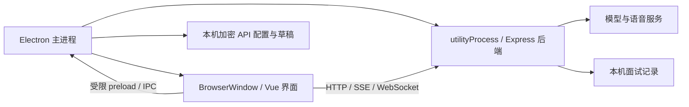

# AIInterview 桌面版

项目保留 Vue + Vite 网页开发方式，并增加 Electron 桌面入口和 Windows 安装包配置。

新面试开始前会弹出两步准备窗口：先粘贴简历（必填），再填写职位 JD（选填）。JD 留空或只包含空白时，使用项目现有的“前端工程师（应届生）”岗位描述。简历最多 20,000 字符，JD 最多 10,000 字符。点击“开始面试”后由面试官主动开场，开场完成后开始计时；填写资料期间不计时。

准备窗口支持返回修改和保存草稿。开始失败可以重试；已创建的面试资料固定，开场重试不会重复创建会话。恢复已有面试时会恢复原有简历、JD 和问答记录；“开始新面试”会重新打开准备窗口。新功能兼容之前保存的记录。

输入的简历和 JD 会在点击“开始面试”后随模型请求发送到配置的 AI 服务，供开场、后续提问和反馈使用；本地会话缓存及记录也会保存这些资料。反馈根据实际面试回答提供引用依据，简历中的技能声明不会直接视为已证明的能力。此流程复用现有模型设置，网页与桌面版均可使用。

## 1. 先启动桌面开发模式

开发电脑需要 Node.js 22.14 或更新版本。推荐 pnpm 10.26 或更新版本；已安装好依赖的旧版 pnpm 也可以运行构建和启动命令。

```powershell
pnpm install
pnpm desktop:dev
```

`desktop:dev` 会先编译后端，然后启动 Electron、内置 Express 后端和 Vite。只需要运行这一条启动命令。前端修改仍会热更新；修改 `electron/` 或 `backend/` 后，需要退出应用并重新运行该命令。

开发模式的 Vite 使用 `127.0.0.1:4399`。如果该端口已经被网页版占用，先停止对应的开发服务。

开发模式会读取项目根目录的 `.env`、`.env.local`。也可以在应用菜单“应用 → API 设置…”中保存配置；保存后的桌面配置优先使用。快捷键为 `Ctrl+,`。

## 2. 构建与打包

```powershell
# 编译前端和桌面后端，不需要启动 Electron
pnpm build:desktop

# 用编译后的前端启动桌面版，检查接近发布版的表现
pnpm desktop:preview

# 生成可运行目录
pnpm desktop:pack

# 在 Windows 上生成 x64 安装程序
pnpm desktop:dist
```

当前版本对应的输出：

```text
release/
  win-unpacked/
    AIInterview.exe
  AIInterview-Setup-0.1.0-x64.exe
```

`desktop:pack` 生成整个运行目录。分享这个版本时需要把整个 `win-unpacked` 文件夹一起打包。`desktop:dist` 生成可以直接发给用户的安装程序。

安装程序包含 Electron 运行环境、前端和后端。使用者无需安装 Node.js 或 pnpm；调用模型和云端语音服务仍需要网络及自己的 API 配置。构建安装程序时，electron-builder 首次可能还需要下载打包工具。

Windows 的 NSIS 安装程序支持选择安装目录、创建快捷方式。卸载默认保留用户数据。当前没有配置应用签名、自定义图标或自动更新；这些可以在准备对外发布时继续补充。

已完成前端类型检查、Vite 构建、后端编译和 21 项业务/存储测试。Electron 开发模式及打包后的桌面应用通过运行测试，Windows x64 安装程序已生成。运行测试使用本地模拟模型和合成麦克风；真实模型服务、真实录音设备和安装向导仍需按你的实际环境体验。

## 3. 安装版如何配置 API

正式安装版首次启动时，如果缺少模型配置，会打开 API 设置窗口。

| 设置项 | 用途 |
| --- | --- |
| `DEEPSEEK_API_KEY` | 对话模型密钥，沿用现有项目字段名 |
| `BASE_URL` | 兼容 OpenAI API 的基础地址，沿用现有网页版地址 |
| `AI_MODEL` | 服务商支持的模型名称 |
| `STT_API_KEY` | 可选，现有火山引擎语音识别服务密钥 |
| `TTS_API_KEY` | 可选，现有火山引擎语音合成服务密钥 |
| `TTS_RESOURCE_ID` | 语音合成资源 ID |
| `TTS_VOICE_NAME` | 合成音色名称 |

语音合成的三项配置需要全部填写，或者全部留空。保存时会重新启动后端并刷新主界面，请等待当前回复完成后再保存。已保存的面试记录和输入草稿会恢复；未完成的模型请求需要重试。

设置保存时只验证字段格式，不会调用模型服务。填写错误的密钥或模型名称，要在实际请求时才能发现。

API 配置通过 Electron `safeStorage` 加密后保存在本机用户数据目录。Windows 使用系统密钥保护；该文件通常不能直接复制给另一个 Windows 用户使用。项目的 `.env.local` 和面试记录不会放进安装包。不要把自己的模型密钥写入前端源码。

## 4. Electron 在这个项目里做了什么

可以把它理解为：Electron 负责窗口和桌面能力，Vue 负责界面，Express 负责模型及语音请求。



三个关键概念：

1. **主进程**：`electron/main.cjs` 管理窗口、菜单、配置和后端生命周期。应用关闭时会停止内置后端。
2. **渲染进程**：现有 Vue 界面。它仍通过 `/api` 请求业务功能，Node.js 集成关闭，窗口开启隔离与沙箱。
3. **preload 和 IPC**：Vue 需要保存桌面草稿时，通过 `electron/preload.cjs` 提供的三个固定操作调用主进程。界面没有任意文件读写权限，也拿不到模型密钥。

后端通过 Electron 的 `utilityProcess` 在独立进程中运行，使用 Electron 自带的 Node.js。生产模式中它同时提供 `dist/` 静态页面和 `/api` 接口，因此现有的流式回复、语音 WebSocket 地址可以继续使用。开发模式重新连接后端时，只更新 Vite 代理的目标和访问令牌，Vite 与热更新连接会继续运行。

每次启动使用一个空闲的本机端口，只监听 `127.0.0.1`。Electron 给发往内置后端的请求附加一次性令牌；没有令牌的请求会被拒绝。模型密钥只传给后端。

普通浏览器的 `localStorage` 按页面地址保存数据，而随机端口会改变页面地址。因此桌面版把当前面试缓存保存到固定文件，重启后端或者应用时仍可恢复草稿和会话 ID。网页版继续使用原有的 `localStorage`。

## 5. 修改代码时看哪些文件

| 文件 | 负责什么 |
| --- | --- |
| `electron/main.cjs` | 创建窗口、启动后端、菜单、权限及 IPC |
| `electron/backend-worker.cjs` | 启动编译后的后端，并向主进程报告端口 |
| `electron/preload.cjs` | 主界面只能读取、保存、清除当前面试缓存 |
| `electron/settings.html` / `settings.js` / `settings.css` | API 设置窗口 |
| `electron/settings-preload.cjs` | 设置窗口读取和保存配置的桥接 |
| `electron/storage.cjs` | 配置与缓存校验、原子文件写入 |
| `scripts/build-electron.mjs` | 使用 esbuild 编译后端 TypeScript |
| `scripts/smoke-electron.mjs` | 启动实际 Electron 窗口执行面试流程测试并保存截图 |
| `scripts/verify-package.mjs` | 检查安装包、必需文件和私有数据排除情况 |
| `electron-builder.yml` | 安装包名称、包含文件、平台和安装方式 |
| `src/lib/sessionCache.ts` | 网页与桌面的缓存适配 |

前端业务改动继续写在 `src/`；面试、模型或语音逻辑继续写在 `backend/`。改窗口大小、菜单或启动方式时，修改 `electron/main.cjs`。发布新版本时，修改 `package.json` 的 `version`，再运行 `pnpm desktop:dist`。

## 6. 数据目录与排查

应用菜单“应用 → 打开数据目录”可以直接打开对应文件夹。

| 模式 | Windows 数据目录 |
| --- | --- |
| 安装版 | `%APPDATA%\AIInterview` |
| 从源码启动，包括开发和预览 | `%APPDATA%\AIInterview-dev` |

目录中主要包括 `api-config.enc`（加密配置）、`sessions/`（面试记录）、`current-interview.json`（当前会话及草稿）、`desktop.log`（运行日志）。浏览器版旧记录不会自动迁入桌面版。

出现无法连接时，可尝试“应用 → 重新连接后端”。启动失败时查看 `desktop.log`。清理数据前先备份；面试记录和草稿包含你的回答内容。

Electron 下载不完整时，先把开发依赖安装好，再下载当前项目版本的运行时：

```powershell
pnpm install --ignore-scripts
node node_modules/electron/install.js
```

如需使用镜像，可在当前 PowerShell 会话中设置：

```powershell
$env:ELECTRON_MIRROR = 'https://npmmirror.com/mirrors/electron/'
node node_modules/electron/install.js
```

项目根目录的 `pnpm-workspace.yaml` 允许 Electron 和 esbuild 的安装脚本。若使用旧版 pnpm，先升级到 10.26 或更新版本。

如果后续需要验证运行时，项目提供：

```powershell
# 原有业务测试与新增配置、缓存测试，不启动 Electron
pnpm test

# 先构建，再测试 Electron 窗口、API、WebSocket、重连草稿恢复和退出清理
pnpm build:desktop
pnpm desktop:smoke

# 对打包目录中的应用执行相同测试
pnpm desktop:smoke release/win-unpacked/AIInterview.exe

# 检查开发模式的 Vite 代理与后端重连
pnpm desktop:smoke --dev

# 检查打包文件和私有配置排除情况
pnpm desktop:verify
```

Smoke 测试使用临时数据目录和本地模拟模型，不调用付费模型或语音服务，也不会录制真实麦克风。它检查面试准备弹窗、简历/JD 草稿恢复、开场中断重试、默认 JD、API 设置加密与恢复、麦克风权限、摄像头拒绝、WebSocket 重连、流式对话、反馈引用、草稿/反馈恢复以及退出清理。截图会保存到 `release/`，包括主界面、设置和反馈页面。

接口设计参考 [Electron utilityProcess](https://www.electronjs.org/docs/latest/api/utility-process)、[Electron 权限处理](https://www.electronjs.org/docs/latest/api/session)、[electron-builder 配置](https://www.electron.build/configuration/) 和 [pnpm 构建脚本设置](https://pnpm.io/settings#allowbuilds)。
